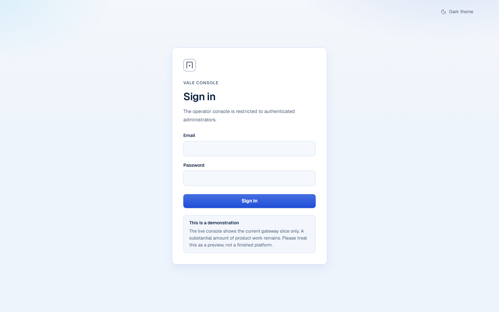
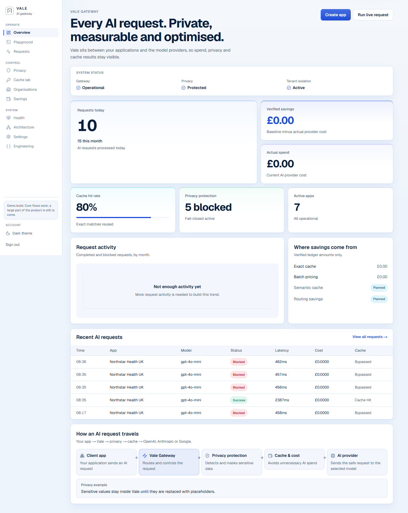
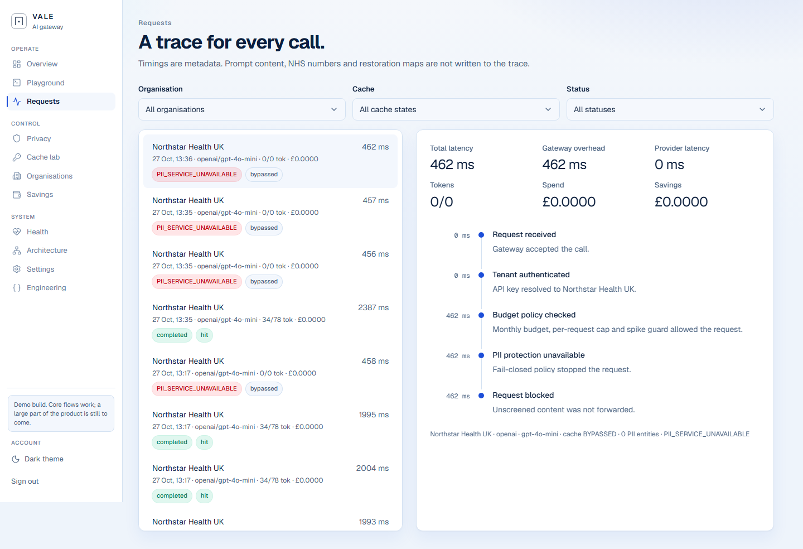
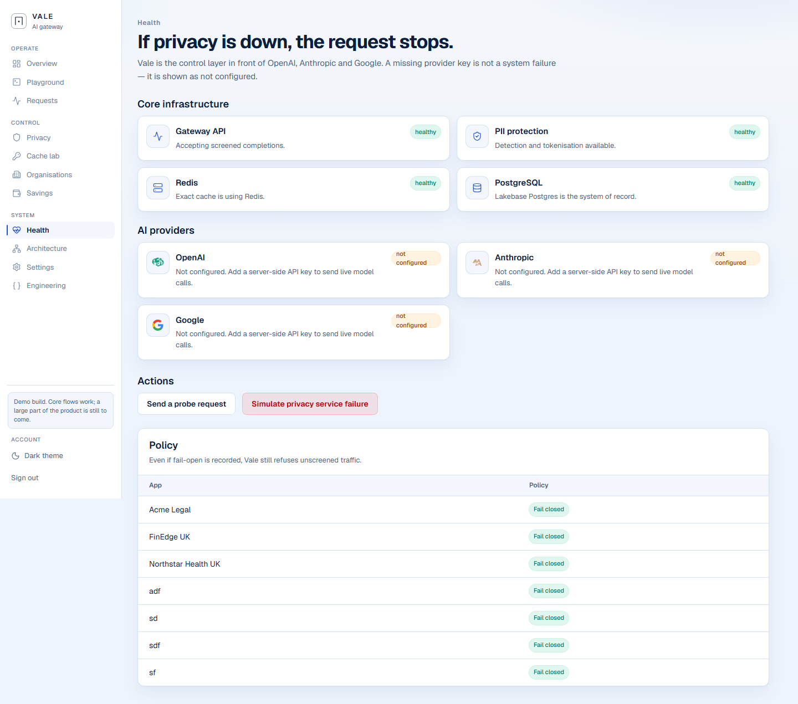
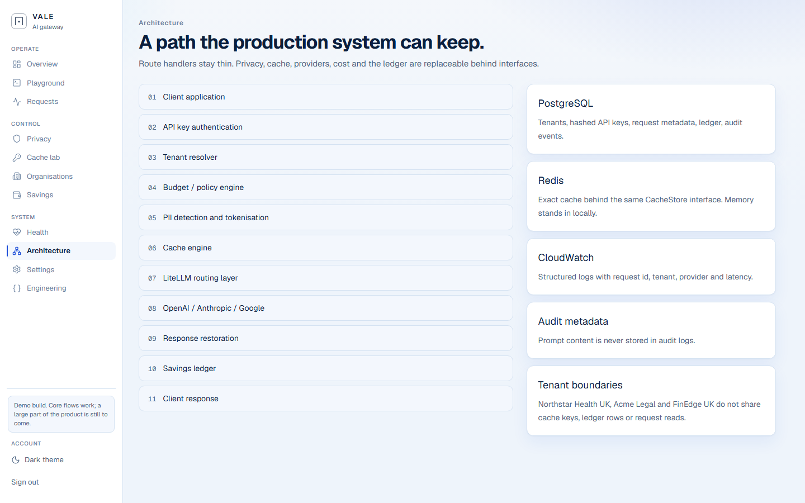

# Vale AI Gateway

**This is a demonstration.** A working slice of the product is live so reviewers can click through the console and see the request path. A large amount of platform work is still remaining. Please treat this repository and the hosted preview as a demo, not a finished commercial product.

Live HTTPS preview: [https://vale.191-215-35-197.sslip.io](https://vale.191-215-35-197.sslip.io)

Client briefing with platform screenshots: [docs/Vale-AI-Gateway-Demo.pdf](docs/Vale-AI-Gateway-Demo.pdf)

Ask the project owner for operator sign-in. Credentials are not published here.

## What Vale is

Vale is a multi-tenant AI cost and privacy gateway. A client application does not call OpenAI, Anthropic or Google directly. It sends a request with an organisation API key. The gateway then:

1. Authenticates the hashed key and resolves the tenant
2. Enforces budget, daily limit and spike guards
3. Screens UK personal data and tokenises it (fail-closed)
4. Looks up an exact cache entry
5. Calls a configured provider with the masked prompt only
6. Restores entities, records cost in money micros, and returns the answer

Prompts, NHS numbers, API keys and provider credentials are not written to the ledger or audit log.

## Platform screenshots

The operator console is blue and white. Every page carries a demonstration notice.

| Console | What you are looking at |
| --- | --- |
|  | Sign-in and the demonstration notice |
|  | Dashboard of volume, savings and health |
|  | Metadata-only traces |
|  | Core services vs unconfigured providers |
|  | Backend request path |

More captures live in [`docs/client-preview`](docs/client-preview).

## Frontend

Next.js App Router console. This is the operator control room, not a marketing site.

| Area | What it does now |
| --- | --- |
| Overview | Live KPIs, charts and the request-flow visual |
| Playground | Sends a completion through the same backend path as the public API |
| Requests | Trace list and detail (metadata only) |
| Privacy | UK PII inspector |
| Cache lab | Exact cache. Semantic cache is planned |
| Organisations / Create app | Tenant onboarding, keys, budget, providers |
| Savings | Verified cache savings only |
| Health | Postgres, Redis, privacy, provider configuration |
| Settings | Server-side provider configuration |
| Architecture / Engineering | System map and remaining work |

Theme: light blue-and-white by default, with a navy dark option.

## Backend

Thin API routes in `src/app/api` validate input. `GatewayService` is the only orchestrator of a completion.

```text
Client application
  -> API key authentication
  -> Tenant resolver
  -> Budget / policy engine
  -> PII detection and tokenisation
  -> Exact cache
  -> Provider port (OpenAI / Anthropic / Google / LiteLLM)
  -> Response restoration
  -> Savings ledger
  -> Client response
```

Stores:

- **Postgres** — tenants, hashed API keys, request metadata, ledger, audit events
- **Redis** — exact cache
- **No prompt store** — placeholder maps and raw prompts are not columns

External API:

- `POST /api/v1/chat/completions`
- `GET /api/v1/models`
- `GET /api/v1/usage`
- `GET /api/v1/health`

`stream=true` returns a lifecycle SSE feed after the full restored response. It is not token-by-token provider streaming.

## Logs

Each completion has a request id. Logs and the Requests screen include that id, tenant, provider, latency, cache status and entity counts.

**Written:** request id, tenant, model, provider, latency, cache hit/miss, cost micros, entity counts, policy decisions.

**Never written:** raw or restored prompt, NHS numbers, API keys, provider credentials, placeholder maps.

## What is done in this demo

- Operator console with session cookie
- Create App onboarding and organisation detail
- External completions API
- UK PII fail-closed screening
- Exact Redis cache and savings ledger
- Health that reports missing provider keys as **not configured**, never as a fake success
- HTTPS on the preview host

## What is still remaining

Please keep this list in view. It is not small.

- Semantic cache
- Model-routing savings
- Token-by-token provider streaming
- Multi-user console accounts (`org_admin` / `viewer` types exist; only the operator can sign in)
- Provider credentials on the preview host
- A real customer domain, billing, SSO, alerting, SLA and the rest of a commercial launch

The console does not invent successful model responses. If a provider key is missing, Health says so.

## Local setup

```bash
npm install
cp .env.example .env.local
npm run dev
```

Local console defaults, only when `DEMO_MODE` is not production: `admin@vale.local` / `vale-admin-change-me`.

Never prefix secrets with `NEXT_PUBLIC_`. Never commit `.env.local`.

| Variable | Purpose |
| --- | --- |
| `DEMO_MODE` | `true` uses a deterministic provider. `false` needs real keys |
| `ADMIN_EMAIL` / `ADMIN_PASSWORD` | Operator console |
| `SESSION_SECRET` | Cookie signing. Unique and long in production |
| `CACHE_HMAC_SECRET` | Required when `DEMO_MODE=false` |
| `DATABASE_URL` | Postgres. Omit for in-memory local use |
| `REDIS_URL` | Exact cache. Omit for in-memory local use |
| `OPENAI_API_KEY` / `ANTHROPIC_API_KEY` / `GOOGLE_API_KEY` | Optional live providers |

See [docs/deployment.md](docs/deployment.md), [docs/architecture.md](docs/architecture.md) and [docs/security.md](docs/security.md).

## Tests

```bash
npm run lint
npm run typecheck
npm run test
npm run build
npm run test:e2e
```

Playwright starts an isolated Next server on port 3100. It does not inherit `.env.local`.

## Licence / status

Private client demonstration. The hosted URL and this repository are for review. They are not a production handover.
